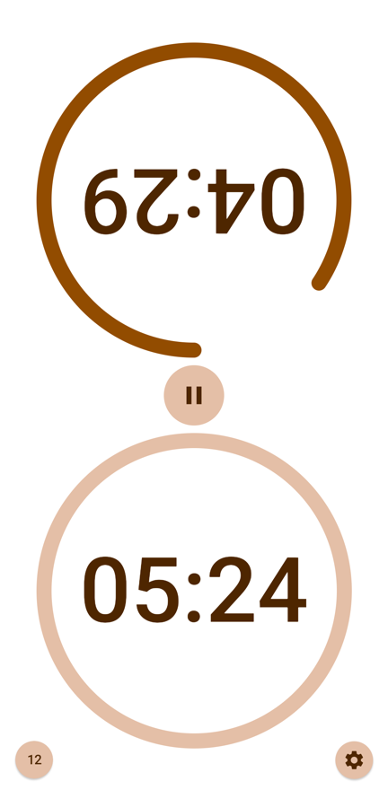
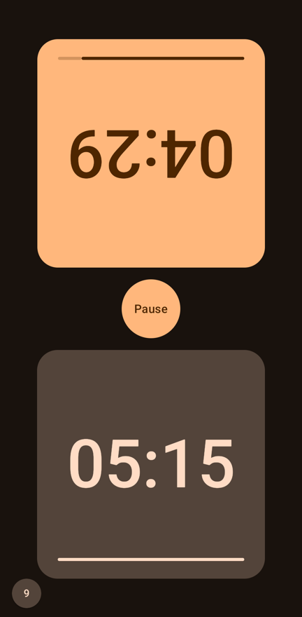
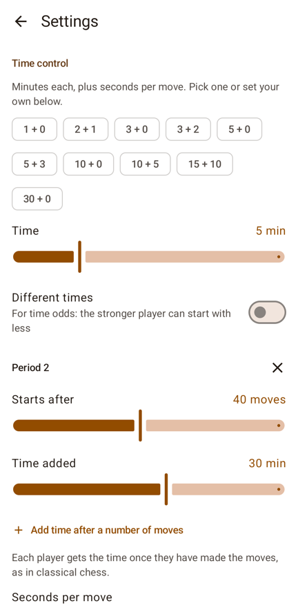
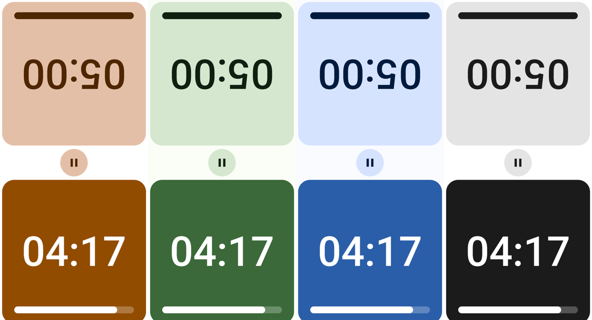
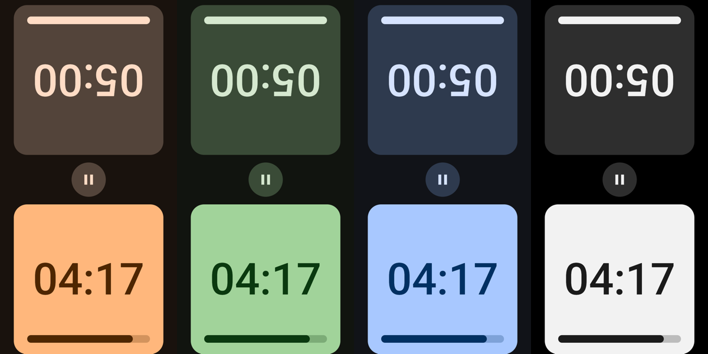

# ChessClock

A two-player chess clock for Android and iPhone. Touch your half of the screen to end your turn and start your opponent's clock.

<p>
  
  
  
</p>

## Design

The idea is a minimal, clean clock that stays out of the way of the game:

- **Two faces and one button.** During play the screen shows only the two times, Pause and the move count; the settings button hides while the clock runs.
- **Color carries the state.** Whose move it is, low time and the result show as color, not as extra labels or icons.
- **One design language.** Rings and panels share the same square, digits and spacing, and differ only in shape.
- **Quiet feedback.** A click confirms a press and a pulse warns of low time, so players can keep their eyes on the board.
- **Every addition earns its place.** A feature or animation goes in only if it is clear, small and useful at the board.

## Features

- **Time controls** – one-tap presets from bullet to rapid (`1 + 0` … `30 + 0`), or your own time from 15 seconds to 6 hours with up to a minute per move
- **Periods** – classical controls in up to three periods: time added once each player has made a number of moves, such as 90 minutes for 40 moves, then 30 more with 30 seconds a move (FIDE)
- **Time odds** – each player can start with their own time, so a stronger player can give a weaker one more
- **Move counter** – the moves played, in the corner opposite settings; it stays during play, and a touch on it still ends the turn
- **Increment or delay** – the seconds per move can be a Fischer increment, a Bronstein increment that gives back only the time a move took, or a simple delay that holds the clock at the start of each move, counted down on the face
- **Seating** – times can face both players, whether they sit at the ends of the phone or at its sides
- **Ready to play** – starts at `5 + 3` with each time turned to its player, for a phone lying between two players across a board
- **Two clock faces** – rings that empty as time runs down, or full-color panels with large digits you can read from across the table
- **Light and dark** – follows the system, or pick one in settings
- **Four color palettes** – Walnut, Forest, Ocean (color-blind friendly) and Graphite (high contrast, true black when dark)
- **Low-time warning** – the face of the player on move turns red under ten seconds
- **Vibration** – a click confirms each press without looking at the clock, two pulses warn at ten seconds left and a long buzz marks a fallen flag; each can be turned off
- **Made for play** – the screen stays on while the clock runs, the settings button hides during play so it can't be hit by accident, and the game pauses when the app goes to the background
- **Quick to the touch** – a turn ends the moment your finger lands, timed by the touch itself, so the app's own handling time is never charged to the player who moved; each tick redraws only the face whose time runs
- **Accessible** – TalkBack and VoiceOver announce whose move it is, any delay, the moves played, setting names and values, and presets in words ("3 minutes, plus 2 seconds per move")

### Palettes




Every palette's text colors meet WCAG AA contrast on their backgrounds, which `PaletteContrastTest` checks on Android and `PaletteContrastTests` on iOS.

## Tech stack

- **Android:** Kotlin 2.4 · Jetpack Compose (Material 3) · ViewModel + StateFlow · Navigation 3 · DataStore · Baseline Profiles · AGP 9.4 · min SDK 28, target SDK 37
- **iPhone:** Swift 6 · SwiftUI · Observation · Core Haptics · XCTest UI tests · iOS 26

## Project layout

```
android/       The Android app (Gradle project; open this folder in Android Studio)
ios/           The iPhone app (Xcode project and the ClockCore Swift package), see ios/README.md
docs/          Screenshots and the Android toolchain explainer
```

Inside `android/`:

```
app/src/main/java/com/lab/chessclock/
  clock/       Chess clock rules: immutable, plain Kotlin
  settings/    ClockSettings and the DataStore-backed SettingsRepository
  haptics/     Vibrations for turn ends, low time and a fallen flag
  ui/clock/    Clock screen and ClockViewModel
  ui/settings/ Settings screen and SettingsViewModel
  ui/theme/    Palettes, clock colors and the Material theme
app/src/release/generated/baselineProfiles/
               The generated baseline profile shipped with release builds
baselineprofile/
               Profile generator and startup benchmark (Macrobenchmark)
```

Dependencies are wired by hand in `AppContainer`, which also loads the settings once at startup so every screen draws with them on its first frame. Versions live in `android/gradle/libs.versions.toml`.

## Build and run

Requires JDK 17+ (Android Studio's bundled JDK works) and the Android SDK with platform 37.

```sh
cd android
./gradlew installDebug              # build and install on a running emulator/device
./gradlew testDebugUnitTest         # unit tests, no device needed
./gradlew connectedDebugAndroidTest # Compose UI tests on an emulator/device
./gradlew assembleRelease           # R8-shrunk release APK with the baseline profile (unsigned)
```

## Performance

Release builds ship a [baseline profile](https://developer.android.com/topic/performance/baselineprofiles/overview), so the code a game uses is compiled ahead of time instead of interpreted until the JIT warms up. The clock reports when it is fully drawn, so startup can be measured up to the moment the clock appears.

```sh
cd android
./gradlew :app:generateBaselineProfile   # re-record the profile after UI changes (API 33+ device or emulator)
./gradlew :baselineprofile:connectedBenchmarkReleaseAndroidTest \
  -Pandroid.testInstrumentationRunnerArguments.class=com.lab.chessclock.baselineprofile.StartupBenchmark
```

The benchmark compares cold start with and without the profile. Use a physical device for real numbers: an emulator that renders in software hides most of the profile's effect.

## iPhone

The SwiftUI app in [`ios/`](ios/README.md) has the same features, colors and defaults as the Android app. Its clock rules, settings and palettes live in the ClockCore Swift package, ported from the Android code and tested with `swift test`.

## Docs

[`docs/android-toolchain-map.html`](docs/android-toolchain-map.html) explains how the JDK, Gradle, AGP, Kotlin, the SDK and the emulator fit together.
