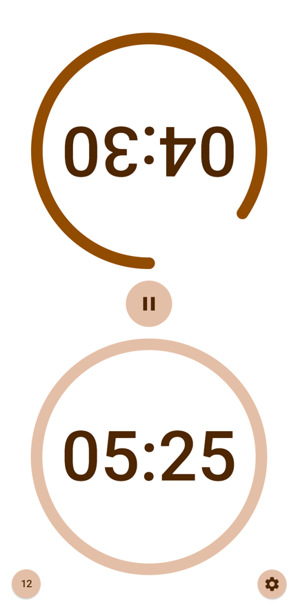
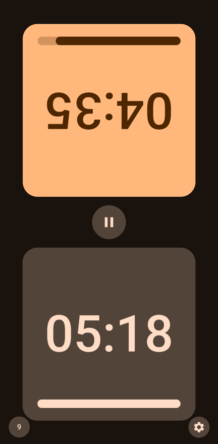
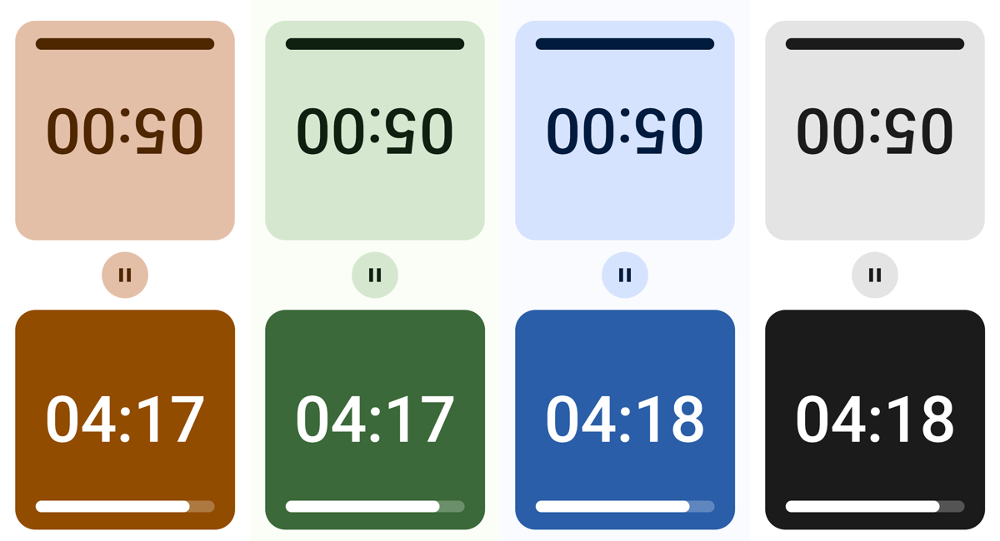
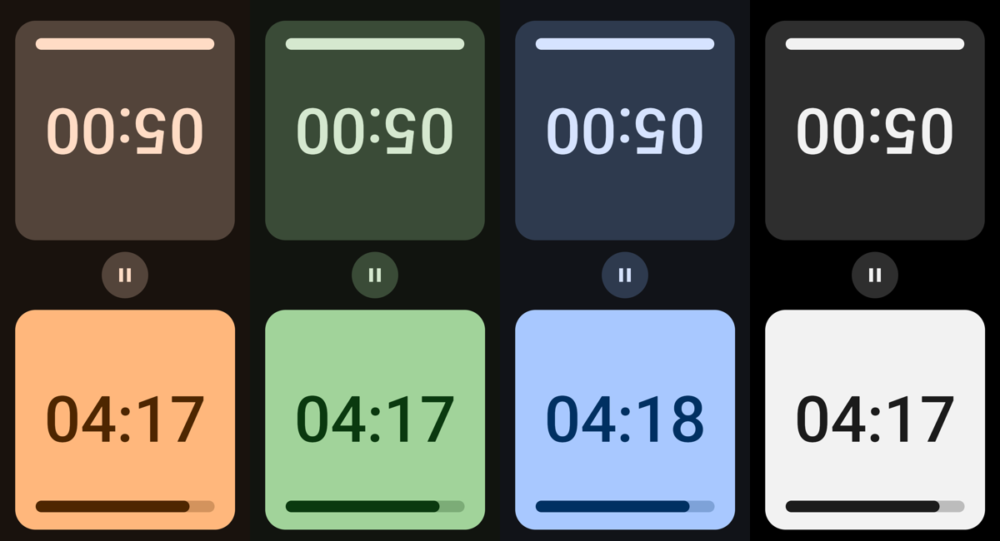

<div align="center">

# ♟️ ChessClock

**A minimal chess clock for Android and iPhone.**

A clean and concise design: two faces, one button, and nothing else in the way of the game.
Touch your half of the screen to end your turn and start your opponent's clock.


&nbsp;

&nbsp;


</div>

---

## Features

- **Time controls** – one-tap presets from bullet to rapid (`1 + 0` … `30 + 0`), or your own time from 15 seconds to 6 hours with up to a minute per move
- **Periods** – classical controls in up to three periods: time added once each player has made a number of moves, such as 90 minutes for 40 moves, then 30 more with 30 seconds a move (FIDE)
- **Time odds** – each player can start with their own time, so a stronger player can give a weaker one more
- **Move counter** – the moves played, in the corner opposite settings; it is only a label, and a touch on it does nothing
- **Increment or delay** – the seconds per move can be a Fischer increment, a Bronstein increment that gives back only the time a move took, or a simple delay that holds the clock at the start of each move, counted down on the face
- **Seating** – times can face both players, whether they sit at the ends of the phone or at its sides
- **Ready to play** – starts at `5 + 3` with each time turned to its player, for a phone lying between two players across a board
- **Two clock faces** – rings that empty as time runs down, or full-color panels with large digits you can read from across the table
- **Light and dark** – follows the system, or pick one in settings
- **Four color palettes** – Walnut, Forest, Ocean (color-blind friendly) and Graphite (high contrast, true black when dark)
- **Low-time warning** – the face of the player on move turns red under ten seconds
- **Vibration** – a click confirms each press without looking at the clock, two pulses warn at ten seconds left and a long buzz marks a fallen flag; each can be turned off
- **Made for play** – the screen stays on while the clock runs, and the game pauses when settings open or the app goes to the background
- **Quick to the touch** – a turn ends the moment your finger lands, timed by the touch itself, so the app's own handling time is never charged to the player who moved; each tick redraws only the face whose time runs
- **Accessible** – TalkBack and VoiceOver announce whose move it is, any delay, the moves played, setting names and values, and presets in words ("3 minutes, plus 2 seconds per move")

### Design

The screen holds only what play needs: two faces, the play, pause and reset button, and the move count and settings small in the corners. Color carries the state, so whose move it is, low time and the result need no labels, and rings and panels share one square, the same digits and the same stroke of remaining time, differing only in shape. Feedback is quiet: a click confirms a press and a pulse warns of low time, so players keep their eyes on the board.

### Palettes




Every palette's text colors meet WCAG AA contrast on their backgrounds, which `PaletteContrastTest` checks on Android and `PaletteContrastTests` on iOS.

## Tech stack

- **Android:** Kotlin 2.4 · Jetpack Compose (Material 3) · ViewModel + StateFlow · Navigation 3 · DataStore · Baseline Profiles · AGP 9.4 · min SDK 28, target SDK 37
- **iPhone:** Swift 6 · SwiftUI · Observation · Core Haptics · XCTest UI tests · iOS 26

## Project layout

```
android/       The Android app: a Gradle project, opened in Android Studio
ios/           The iPhone app: an Xcode project and the ClockCore Swift package
screenshots/   The pictures in this README
```

Inside `android/`:

```
app/src/main/java/com/lab/chessclock/
  clock/       Chess clock rules: immutable, plain Kotlin
  settings/    ClockSettings and the DataStore-backed SettingsRepository
  haptics/     Vibrations for turn ends, low time and a fallen flag
  ui/clock/    Clock screen and ClockViewModel
  ui/settings/ Settings screen and SettingsViewModel
  ui/theme/    Palettes, clock colors and the Material theme
baselineprofile/
               Generator of the baseline profile release builds ship, and a startup benchmark
```

Dependencies are wired by hand in `AppContainer`, which also loads the settings once at startup so every screen draws with them on its first frame. Versions live in `android/gradle/libs.versions.toml`.

Inside `ios/`:

```
ClockCore/          Swift package: clock rules, settings and palettes, ported from the Android
                    app and tested with `swift test`
ChessClock/         SwiftUI app: clock screen, settings sheet, ClockModel that runs the clock,
                    haptics, and the settings saved as JSON in UserDefaults
ChessClockUITests/  XCUITests that play the app on a simulator
```

The two apps match feature for feature; each follows its platform where it should, with sliders and a settings screen on Android, steppers and a settings sheet on iPhone.

## Build and run

### Android

Requires JDK 17+ (Android Studio's bundled JDK works) and the Android SDK with platform 37.

```sh
cd android
./gradlew installDebug              # build and install on a running emulator or device
./gradlew testDebugUnitTest         # unit tests, no device needed
./gradlew connectedDebugAndroidTest # Compose UI tests on an emulator or device
./gradlew assembleRelease           # R8-shrunk release APK with the baseline profile (unsigned)
```

### iPhone

Requires Xcode 27. Open `ios/ChessClock.xcodeproj` and run the ChessClock scheme, or from the shell:

```sh
cd ios
xcodebuild -project ChessClock.xcodeproj -scheme ChessClock \
  -destination 'platform=iOS Simulator,name=iPhone 17 Pro' build      # build for a simulator
(cd ClockCore && swift test)                                           # rules, settings and palette tests, no simulator needed
xcodebuild test -project ChessClock.xcodeproj -scheme ChessClock \
  -destination 'platform=iOS Simulator,name=iPhone 17 Pro'            # UI tests on a simulator
```
