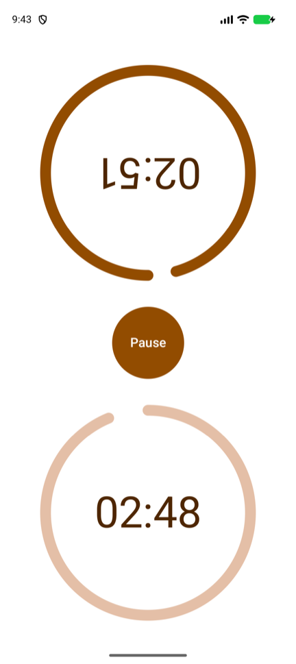
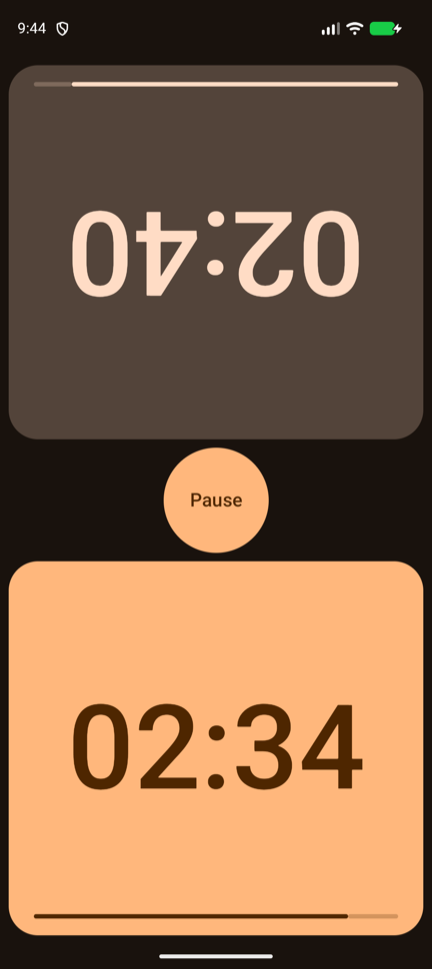
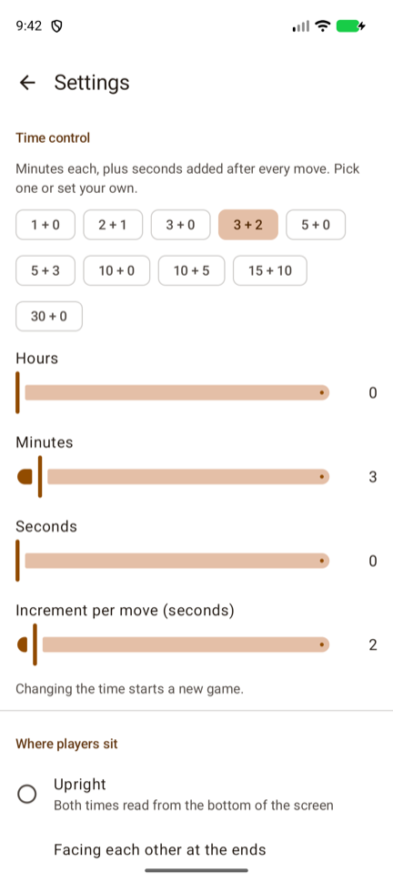
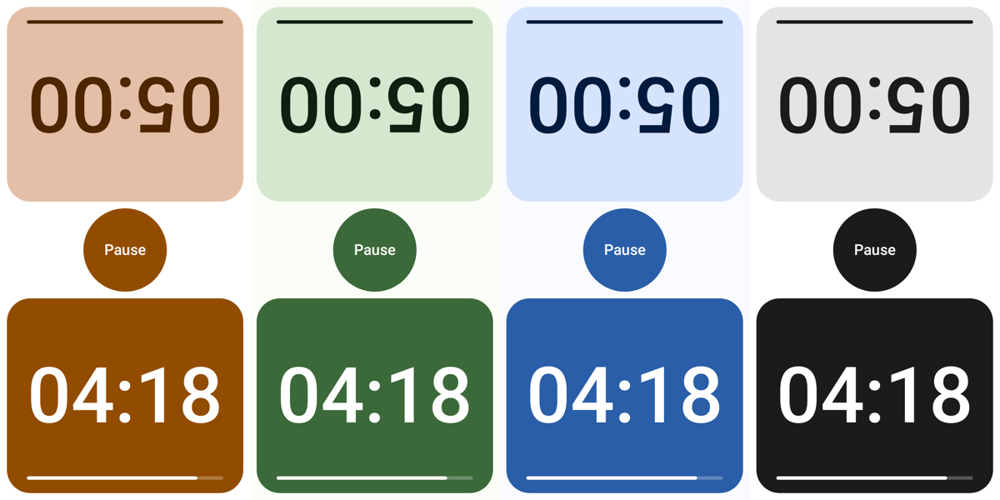
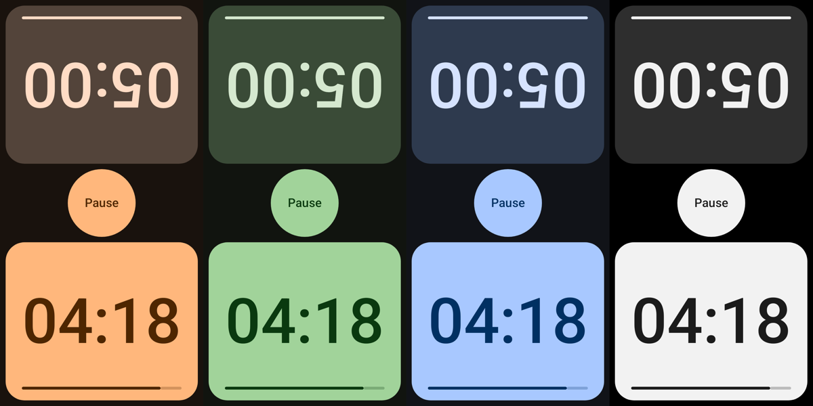

# ChessClock

A two-player chess clock for Android. Tap your half of the screen to end your turn and start your opponent's clock.

<p>
  
  
  
</p>

## Features

- **Time controls** – one-tap presets from bullet to classical (`1 + 0` … `30 + 0`), or your own hours, minutes and seconds with an increment of up to a minute per move
- **Increment or delay** – the seconds per move can be a Fischer increment, a Bronstein increment that gives back only the time a move took, or a simple delay that holds the clock at the start of each move, counted down on the face
- **Seating** – times can face both players, whether they sit at the ends of the phone or at its sides
- **Ready to play** – starts at `5 + 3` with each time turned to its player, for a phone lying between two players across a board
- **Two clock faces** – rings that empty as time runs down, or full-color panels with large digits you can read from across the table
- **Light and dark** – follows the system, or pick one in settings
- **Four color palettes** – Walnut, Forest, Ocean (color-blind friendly) and Graphite (high contrast, true black when dark)
- **Low-time warning** – the face of the player on move turns red under ten seconds
- **Vibration** – a click confirms each press without looking at the clock, two pulses warn at ten seconds left and a long buzz marks a fallen flag; each can be turned off
- **Made for play** – the screen stays on while the clock runs, the settings button hides during play so it can't be hit by accident, and the game pauses when the app goes to the background
- **Accessible** – TalkBack announces whose move it is, slider names and values, and presets in words ("3 minutes, plus 2 seconds per move")

### Palettes




Every palette's text colors meet WCAG AA contrast on their backgrounds, which `PaletteContrastTest` checks.

## Tech stack

Kotlin 2.4 · Jetpack Compose (Material 3) · ViewModel + StateFlow · Navigation 3 · DataStore · Baseline Profiles · AGP 9.4 · min SDK 28, target SDK 37

## Project layout

```
app/src/main/java/com/lab/chessclock/
  clock/       Chess clock rules: immutable, plain Kotlin
  settings/    ClockSettings and the DataStore-backed SettingsRepository
  ui/clock/    Clock screen and ClockViewModel
  ui/settings/ Settings screen and SettingsViewModel
  ui/theme/    Palettes, clock colors and the Material theme
app/src/release/generated/baselineProfiles/
               The generated baseline profile shipped with release builds
baselineprofile/
               Profile generator and startup benchmark (Macrobenchmark)
```

Dependencies are wired by hand in `AppContainer`, which also loads the settings once at startup so every screen draws with them on its first frame. Versions live in `gradle/libs.versions.toml`.

## Build and run

Requires JDK 17+ (Android Studio's bundled JDK works) and the Android SDK with platform 37.

```sh
./gradlew installDebug              # build and install on a running emulator/device
./gradlew testDebugUnitTest         # unit tests, no device needed
./gradlew connectedDebugAndroidTest # Compose UI tests on an emulator/device
./gradlew assembleRelease           # R8-shrunk release APK with the baseline profile (unsigned)
```

## Performance

Release builds ship a [baseline profile](https://developer.android.com/topic/performance/baselineprofiles/overview), so the code a game uses is compiled ahead of time instead of interpreted until the JIT warms up. The clock reports when it is fully drawn, so startup can be measured up to the moment the clock appears.

```sh
./gradlew :app:generateBaselineProfile   # re-record the profile after UI changes (API 33+ device or emulator)
./gradlew :baselineprofile:connectedBenchmarkReleaseAndroidTest \
  -Pandroid.testInstrumentationRunnerArguments.class=com.lab.chessclock.baselineprofile.StartupBenchmark
```

The benchmark compares cold start with and without the profile. Use a physical device for real numbers: an emulator that renders in software hides most of the profile's effect.

## iPhone

A SwiftUI version is under way in [`ios/`](ios/README.md), sharing the same clock rules.

## Docs

[`docs/android-toolchain-map.html`](docs/android-toolchain-map.html) explains how the JDK, Gradle, AGP, Kotlin, the SDK and the emulator fit together.
